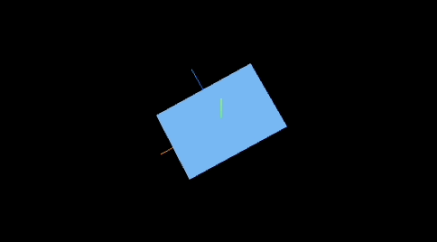

# 学习路线

## 入门

- 点、线、面、几何体、材质、物体、场景、相机、渲染器、动画、控制器，以及各类的属性和概念
- PBR，PBR 基于物理的光照原理的渲染
- 环境贴图、凹凸贴图、置换贴图、放射光、环境贴图、金属贴图、粗糙度贴图
- 绘制粒子群，绘制雨雪、落叶、星河等粒子效果

## 进阶

- 与物体的交互
- 物理引擎，实现重力、反弹
- 着色器语言，控制 GPU 渲染
- 曲线和物体运动结合
- blender + 优化

> 当前 `ThreeJS` 版本为 `r150`，不同版本之间可能存在 API 差异

https://stemkoski.github.io/Three.js/index.html

#



```tsx
import { useEffect, useRef, useState } from "react";

import * as THREE from "three";
import { OrbitControls } from "three/examples/jsm/controls/OrbitControls.js";

function Demo() {
  const renderRef = useRef<any>();

  useEffect(() => {
    if (!renderRef.current) return;
    init(renderRef.current);
  }, [renderRef]);

  const init = (currentDom: any) => {
    /**
     * 1. 初始化场景
     */
    const scene = new THREE.Scene();

    /**
     * 2. 初始化相机
     * [camera](https://threejs.org/examples/#webgl_camera)
     * 说明：可以看到绿色球体超过橙色视锥体范围之外就会消失不见
     */
    const camera = new THREE.PerspectiveCamera(
      75,
      currentDom.clientWidth / currentDom.clientHeight,
      0.1,
      1000
    );
    // 设置相机位置
    camera.position.set(3, 1, 20);

    /**
     * 3. 初始化渲染器
     */
    const renderer = new THREE.WebGLRenderer({ antialias: true });
    renderer.setSize(currentDom.clientWidth, currentDom.clientHeight);
    currentDom.appendChild(renderer.domElement);

    /**
     * 4. 初始化网格 mesh = 几何体 geometry + 材质 material
     */
    const geometry = new THREE.BoxGeometry(1, 2, 3);
    const material = new THREE.MeshLambertMaterial({ color: "#fff" });
    const cube = new THREE.Mesh(geometry, material);
    scene.add(cube);

    /**
     * 5. 坐标辅助线
     * 说明：x-红色 y-绿色 z-蓝色
     */
    const axesHelper = new THREE.AxesHelper(2); // 2 表示坐标轴长度
    scene.add(axesHelper);

    /**
     * 6. 轨道控制器
     */
    new OrbitControls(camera, renderer.domElement);

    /**
     * 7. 光照
     * 说明：MeshBasicMaterial 材质不受光照的影响
     */
    const light = new THREE.AmbientLight("#6ab5f6");
    scene.add(light);

    /**
     * 8. 渲染
     */
    const animate = function () {
      cube.rotation.x += 0.01;
      cube.rotation.y += 0.01;
      requestAnimationFrame(animate);
      renderer.render(scene, camera);
    };
    animate();
    // render.render(scene, camera);
  };

  return (
    <div
      id="container"
      ref={renderRef}
      style={{ width: 500, height: 300 }}
    ></div>
  );
}

export default Demo;
```
