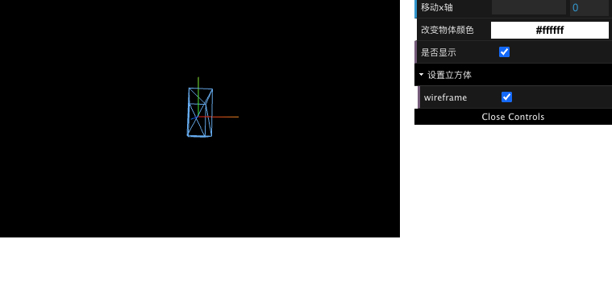

# 可视化配置窗口



## 安装

```bash
npm install --save dat.gui
npm i --save-dev @types/dat.gui
```

## 调用案例

```tsx
import * as dat from "dat.gui";
let gui: any = null;

function Demo() {
    ...
    scene.add(cube);

    if (!gui) { // 防止重复渲染
      gui = new dat.GUI();
      gui
        .add(cube.position, "x")
        .min(0)
        .max(5)
        .step(0.1)
        .name("移动x轴")
        .onChange((value: any) => {
          console.log(value, "change value...");
        })
        .onFinishChange((value: any) => {
          console.log(value, "finish value...");
        });

      gui
        .addColor({ color: "#fff" }, "color")
        .name("改变物体颜色")
        .onChange((value: any) => {
          console.log(value, "change color value...");
          cube.material.color.set(value);
        });

      gui.add(cube, "visible").name("是否显示");

      const folder = gui.addFolder("设置立方体");
      folder.add(cube.material, "wireframe");
    }


    ...
}

```

## 插件

1. gui
2. stats

监测 fps

threejs 已经自带

```tsx
import Stats from "three/examples/jsm/libs/stats.module";

const stats = Stats();
stats.setMode(0);

// 设置监视器位置
stats.domElement.style.position = "absolute";
stats.domElement.style.left = "0px";
stats.domElement.style.top = "0px";

// 将监视器添加到页面中
currentDom.appendChild(stats.domElement);
```
